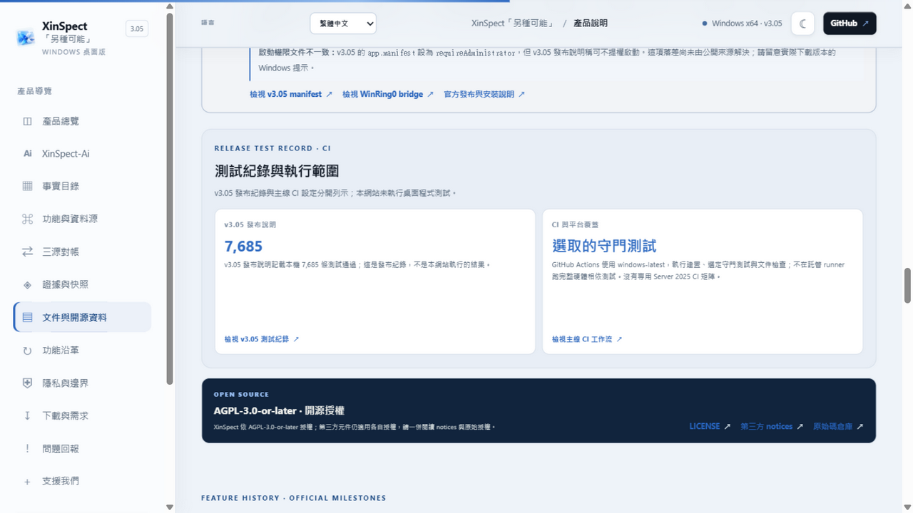

# ⚠ 測試版（TEST BUILD）— XinSpect-Ai 1.7B

這個 repo 是**測試用途**，不是正式發佈物。裡面的模型、評測與程式碼都還在驗證階段，
數字會變、行為會變。要用在正式場合，請先看完 [`TEST-REPORT.md`](TEST-REPORT.md)
裡「目前做不到的事」那一段。

XinSpect-Ai 是[曦覽（XinSpect）](https://github.com/Xinglanclever/XinSpect)官網的
三語（繁體中文／简体中文／English）硬體與文件助手：
底座 Qwen3-1.7B ＋ 我們自己的 LoRA，合併後量化成 Q4_K_M（1,107 MB）。



## 這台模型是做什麼的

它**只負責「怎麼講」**，不負責「講什麼」。事實來自兩條路徑，都不在權重裡：

| 路徑 | 誰回答 | 例子 |
|---|---|---|
| 查表 | `rag/entities.py` 直接從 SQLite 抄，不進模型 | 「9800X3D 的 L3 多大」→ 96 MB |
| 檢索 ＋ 生成 | BM25 命中片段進提示，模型照片段講，伺服器等把不出的行號修掉 | 「曦覽怎麼做三源對帳」 |
| 固定回答 | 機器專屬問題走寫好的死路，不給模型碰 | 「我的 CPU 幾度」→ 讀不到，並指出去哪裡讀 |

沒有〔資料片段〕的時候它**會硬編出處**（訓練資料每一筆答案都有出處，它把「一定要有出處」
學過頭了）。所以這個 zip 的定位是「接檢索時用的生成端」，不是「問它曦覽的事實」。

## 怎麼跑

### 1. 只有模型（Ollama）

從 Releases 下載 `XinSpect-Ai-1.7B-Q4_K_M-v5.zip`（1.1 GB，含 gguf ＋ Modelfile ＋
`run-ollama.cmd` ＋ 系統提示），解壓後：

```cmd
run-ollama.cmd
```

或手動 `ollama create xinspect-ai -f modelcard\Modelfile` ＋ `ollama run xinspect-ai`。
LM Studio／llama.cpp 也能直接載入 gguf，系統提示貼 `modelcard/SYSTEM-PROMPT.txt`。

### 2. 端到端（含檢索與查表）

```cmd
cd server
set XINSPECT_RATE_LIMIT=10000
start.cmd --upstream ollama --model xinspect-ai:1.7b-v5 --port 8793
```

⚠ 這個 repo **不含檢索索引與 `entities.db`**（曦覽文件與型號庫屬主專案，授權不同）。
沒有索引時伺服器的檢索會回「查無資料」，只能驗模型本身。要重跑下面的評測數字，
請在主專案裡執行，或依 `corpus/*.py` 自行重建索引。

## 2026-11-01 實測（110 題，Q4_K_M v5，Ollama 本機）

| 指標 | 結果 |
|---|---|
| 應該回答的 65 題 | 答了 63（97%） |
| 應該拒答的 45 題 | 拒了 32（71%） |
| 帶期望值的 14 題硬體值 | 寫對 **14/14（100%）** |
| 答案行號對得上檢索結果 | 26/27（96%） |
| 延遲 | 中位數 0.0 秒（查表題完全沒呼叫模型），最慢 3.9 秒 |

原始逐題結果：`eval/RESULT-2026-11-01-nonc.json`。
同一天也留了修 bug 前那一次：`eval/RESULT-2026-11-01-before-fix.json`（硬體值只有 9/14）。
詳細說明與踩到的坑在 [`TEST-REPORT.md`](TEST-REPORT.md)。

重跑：

```
python eval/make_questions_hw.py          # 期望值從 DB 推，不要手改 JSON
python eval/run_e2e.py --endpoint http://127.0.0.1:8793/v1/xinspect/ask
```

## 目錄

```
server/   xinspect_ai_server.py（RAG＋查表＋拒答閘門＋repair_locators）、start.cmd
rag/      bm25.py／entities.py（查表與授權閘門）／component_query.py（主機板組件庫查詢）
eval/     題庫、run_e2e／eval_split／make_questions_hw，以及三次實測的逐題 JSON
train/    qlora.py（TITAN Xp fp16 LoRA）、export_model.py、package_model.py、verify_model.py
tools/    make_hw_sft.py／make_nocontext_sft.py／merge_sft.py／convert_hf_to_gguf.py
corpus/   匯入腳本（Wikipedia wikitext、晶片組模板、型號庫）——不含任何 DB
modelcard/Modelfile、SYSTEM-PROMPT.txt、run-ollama.cmd
MODEL-CARD.md / TEST-REPORT.md / NOTICE.md
```

## 訓練條件（可重現的部分）

```
底座 Qwen3-1.7B（Apache-2.0，sha256 已驗）    LoRA r=16 alpha=32, fp16
主訓練 5,626 筆 × 2 epochs（文件 1,953 ＋ 硬體 3,673），TITAN Xp 12 GB，約 2 小時
加固兩輪 2,070 筆（無資料不報數字、不編出處、一般知識不給數值）
量化 Q4_K_M（5.12 BPW）
```

## 授權與來源

* 程式碼與權重：Apache-2.0（見 `LICENSE`）。
* 訓練用的硬體欄位是**事實**，句子為自撰；Wikipedia 來源採 CC BY-SA 4.0，
  出處在答案與 `NOTICE.md` 標示。**第三方原文不進訓練集，也不進這個 repo。**
* 主機板組件庫是 CC BY-NC-SA，**不隨這份發佈**；程式碼保留了
  `XINSPECT_ALLOW_NC=1` 閘門，沒開就一定不會讀到它。

## 已知會讓人失望的地方（摘要）

1. 越界提問有 13/45 沒拒（例如「現在幾點？」會撿到文件裡的時鐘對照表）。
2. 問「EPYC 9654 保固幾年」這種**欄位不存在**的問題，查表仍會回傳那一列的其他欄位——
   答非所問，但看起來很像答對了。
3. 1.7B 常以「文件中段的一句話」開頭，不先回答問題；偶爾把問句再抄一遍。
4. 沒有檢索片段時會編造出處檔名（例：把 `README.en.md` 寫成 `XinSpect.md`）。

完整清單與重現問法在 `TEST-REPORT.md`。**這就是它還在測試版的原因。**
